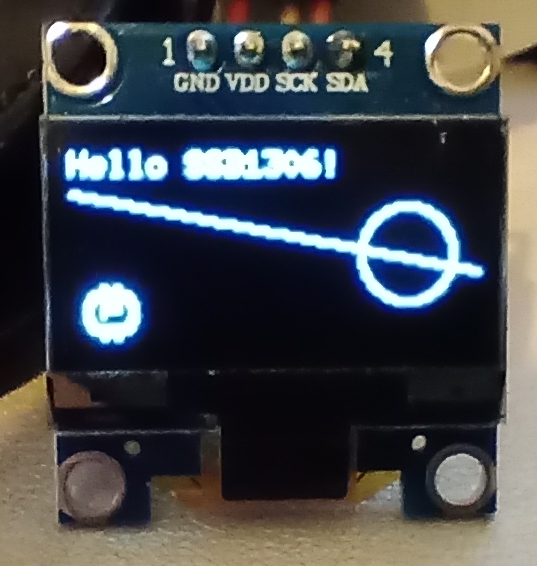
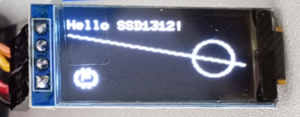
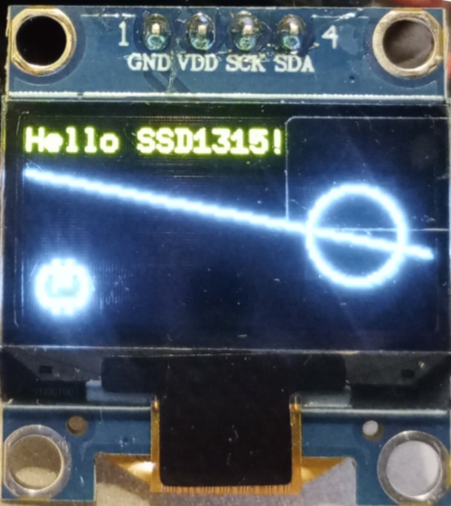
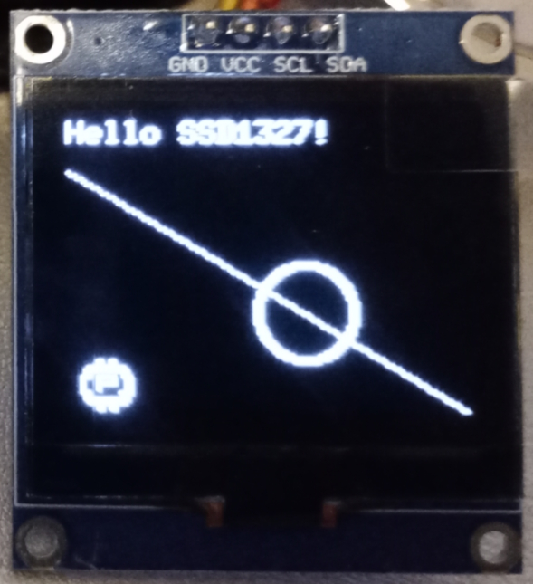
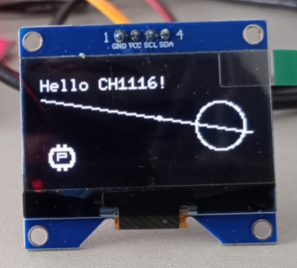

# oled-ssd-driver

A platform-independent, `#![no_std]` Rust driver for **SSD0303**, **SSD1300**, **SSD1306**, **SSD1306B**, **SSD1307**, **SSD1309**, **SSD1312**, **SSD1315**, **SSD1320**, **SSD1325**, **SSD1327**, **SSD1331**, **SSD1332**, **SSD1351**, **SSD1362**, **CH1115**, and **CH1116** OLED display controllers.

Works on any embedded target (ESP32, STM32, nRF, RP2040, etc.) with zero heap allocation.

## Features

- **Seventeen controller support** -- `Ssd0303`, `Ssd1300`, `Ssd1306`, `Ssd1306b`, `Ssd1307`, `Ssd1309`, `Ssd1312`, `Ssd1315`, `Ssd1320`, `Ssd1325`, `Ssd1327`, `Ssd1331`, `Ssd1332`, `Ssd1351`, `Ssd1362`, `Ch1115`, and `Ch1116` structs with separate, optimized init sequences
- **I2C and SPI** -- Generic over `embedded-hal 1.0` bus traits
- **Sync and async** -- Full async API via `embedded-hal-async`
- **embedded-graphics integration** -- Implements `DrawTarget` for the [embedded-graphics](https://github.com/embedded-graphics/embedded-graphics) ecosystem
- **No lifetimes on the driver struct** -- Simple ownership model, easy to store in global statics
- **Internal framebuffer** -- Monochrome (up to 132x64 / 1056 bytes for SSD0303/CH1116, or 104x48 / 624 bytes for SSD1300), 4-bit grayscale (128x80 / 5120 bytes for SSD1325, 128x128 / 8192 bytes for SSD1327, 160x160 / 12800 bytes for SSD1320, 256x64 / 8192 bytes for SSD1362), or 65K color RGB565 (96x64 / 12288 bytes for SSD1331/SSD1332, 128x128 / 32768 bytes for SSD1351), flushed on demand

## Supported Controllers

|                                       | Controller | Manufactured status | Struct          | Tested | Résolution (up to) | Price of device     | Implementation by AI price | Keys Differences | 
|---------------------------------------|------------|---------------------|-----------------|--------|--------------------|---------------------|----------------------------|------------------|
|                                       | SSD0303    | *Discontinued*      | `Ssd0303<DI>`   | ❌     | 132x64             | N/A                 | 3.38€ (2026/05/18)        | internal DC-DC voltage converter, 4 area colour selections, page-mode addressing, horizontal scroll, I2C and SPI, standalone `InitConfig` |
|                                       | SSD1300    | *Discontinued*      | `Ssd1300<DI>`   | ❌     | 104x48             | N/A                 | 3.09€ (2026/05/18)        | internal DC-DC booster, 4 area colour selections, page-mode addressing, horizontal scroll, SPI only (serial write-only), standalone `InitConfig` |
|     | SSD1306    | Active              | `Ssd1306<DI>`   | ✅ I2C | 128x64             | 2,11€ (2025/10/12)  | 5€ (2026/05/12)           | standard charge pump (on/off), 3 VCOMH levels, basic horizontal scroll. Compatible with **SH1106** |
|                                       | SSD1306B   | Active              | `Ssd1306b<DI>`  | ❌     | 128x64             | N/A                 | 2€ (2026/05/12)           | 4 charge pump voltages (6.0-9.0V), internal IREF, 4 VCOMH levels, fade/blink, zoom, content scroll, column-bounded scrolling. Power consumption enhancement compared to SSD1306. Compatible with **SSD1306** |
|                                       | SSD1307    | *Discontinued*      | `Ssd1307<DI>`   | ❌     | 128x39             | N/A                 | 4.7€ (2026/05/15)         | no charge pump (external VCC 7-15V), external IREF, 3 VCOMH levels, horizontal scroll |
|                                       | SSD1309    | Active              | `Ssd1309<DI>`   | ❌     | 128x64             | 7,09€ (2026/10/18)  | 3.29€ (2026/05/15)        | no charge pump (external VCC 7-18V), 3 VCOMH levels (0.64/0.78/0.84 x VCC), horizontal scroll. Compatible with **SH1116** |
|     | SSD1312    | Active              | `Ssd1312<DI>`   | ✅ I2C | 128x64             | 2.09€ (2026/02/17)  | 7€ (2026/05/13)           | 4 charge pump voltages (7.5-10.0V), internal/external IREF, 4 VCOMH levels, content scroll, column-bounded scrolling |
|     | SSD1315    | Active              | `Ssd1315<DI>`   | ✅ I2C | 128x64             | 1.77€ (2026/02/17)  | 3€ (2026/05/13)           | 3 charge pump voltages (7.5-9.0V), internal IREF, 4 VCOMH levels, fade/blink, zoom, content scroll, column-bounded scrolling |
|                                       | SSD1320    | Active              | `Ssd1320<DI>`   | ❌     | 160x160            | 43,99€ (2026/10/18) | 4.64€ (2026/05/15)        | 4-bit grayscale (16 levels), no charge pump (external VCC 8-18V), internal/external IREF, standalone `InitConfig` |
|                                       | SSD1325    | Active              | `Ssd1325<DI>`   | ❌     | 128x80             | 22,59€ (2026/10/18) | 6.36€ (2026/05/18)        | 4-bit grayscale (16 levels), no charge pump (external VCC 8-16V), external IREF via resistor, quarter/half/full current range, VCOMH/precharge voltage control, standalone `InitConfig` |
|     | SSD1327    | Active              | `Ssd1327<DI>`   | ✅ I2C | 128x128            | 10,79€ (2026/08/10) | 3.40€ (2026/05/18)        | 4-bit grayscale (16 levels), internal VDD regulator (enabled by default), 256-step contrast, second precharge period, internal/external VSL, standalone `InitConfig` |
|                                       | SSD1331    | Active              | `Ssd1331<DI>`   | ❌     | 96x64              | 6,29€ (2026/10/18)  | 3€ (2026/05/18)           | 65K color (RGB565), no charge pump (external VCC 8-18V), 256-step contrast per color channel, 16-step master current, SPI only (serial write-only), standalone `InitConfig` |
|                                       | SSD1332    | Active              | `Ssd1332<DI>`   | ❌     | 96x64              | 3,59€ (2026/10/18)  | 3.88€ (2026/05/18)        | 65K color (RGB565), internal DC-DC booster, 256-step contrast per color channel, 16-step master current, separate VPA/VPB/VPC pre-charge voltages, power save mode, SPI only (serial write-only), standalone `InitConfig` |
|                                       | SSD1351    | Active              | `Ssd1351<DI>`   | ❌     | 128x128            | 21,19€ (2026/10/18) | 3.41€ (2026/05/18)        | 65K color (RGB565), internal VDD regulator, 256-step contrast per color channel, 16-step master contrast, SPI only (serial write-only), command lock mechanism, standalone `InitConfig` |
|                                       | SSD1362    | Active              | `Ssd1362<DI>`   | ❌     | 256x64             | 16,89€ (2026/10/18) | 4.50€ (2026/05/18)        | 4-bit grayscale (16 levels), internal VDD regulator, 256-step contrast, internal/external IREF, SEG left/right remap, standalone `InitConfig` |
|                                       | CH1115     | Active              | `Ch1115<DI>`    | ❌     | 128x64             | 2,48€ (2026/10/18)  | 4.09€ (2026/05/19)        | 4 pump voltages (7.4-10.0V), internal/external IREF with 4 resistor values, breathing light effect, horizontal scroll with column bounds, adaptive power save, SEG pads configuration, page-mode addressing |
|       | CH1116     | Active              | `Ch1116<DI>`    | ✅ I2C | 132x64             | 5,73€ (2025/09/05)  | 6€ (2026/05/13)           | 4 pump voltages (6.4-10.0V), internal/external IREF with 4 resistor values, breathing light effect, horizontal scroll with column bounds, page-mode addressing |

## Quick Start

See **[QUICK_START.md](QUICK_START.md)** for usage examples of all supported controllers (I2C, SPI, async, monochrome, grayscale, and color).

## InitConfig

All drivers accept an `InitConfig` struct in their `init()` method to configure the display at startup:

| Field | Type | Default | Description | SSD13xx | CH1115/CH1116 |
|-------|------|---------|-------------|---------|---------------|
| `segment_remap` | `bool` | `true` | Column address mapped in reverse direction to SEG pins | Applied | Applied |
| `com_scan_reversed` | `bool` | `true` | COM scan from COM[N-1] to COM0 (vertically flipped) | Applied | Applied |
| `display_on` | `bool` | `true` | Turn the display on at the end of initialization | Applied | Applied |
| `display_offset` | `u8` | `0` | Vertical shift (0-63) | Applied | Applied |
| `display_start_line` | `u8` | `0` | Display start line (0-63) | Applied | Applied |
| `addressing_mode` | `Option<AddressingMode>` | `Some(Horizontal)` | Memory addressing mode | Applied if `Some` | Ignored (page-mode only) |
| `contrast` | `u8` | `0x7F` | Contrast level (0-255) | Applied | Applied |
| `vcomh_deselect` | `Option<VcomhLevel>` | `Some(V077)` | VCOMH deselect level | Applied if `Some` | Ignored (uses raw u8 API) |
| `entire_display_on` | `bool` | `false` | All pixels lit regardless of RAM content | Applied | Applied |
| `inverse_display` | `bool` | `false` | Swap ON/OFF pixels | Applied | Applied |
| `deactivate_scroll` | `bool` | `true` | Deactivate scroll during init | Applied | Applied |

The `Option<T>` fields (`addressing_mode`, `vcomh_deselect`) are skipped when `None`, which handles device-specific incompatibility. CH1115 and CH1116 ignore these two fields entirely since they use page-mode addressing only and have their own raw VCOM API.

**Note:** `Ssd0303`, `Ssd1300`, `Ssd1320`, `Ssd1325`, `Ssd1327`, `Ssd1331`, `Ssd1332`, `Ssd1351`, and `Ssd1362` use their own `InitConfig` structs (in their respective modules, e.g. `ssd0303::InitConfig`) instead of the shared `InitConfig` because they have fundamentally different register layouts and commands. For convenience, the root re-exports them as `InitConfig0303`, `InitConfig1300`, `InitConfig1320`, `InitConfig1325`, `InitConfig1327`, `InitConfig1331`, `InitConfig1332`, `InitConfig1351`, and `InitConfig1362`.

## Driver-Specific API

Each driver exposes hardware-specific methods beyond the common interface. See **[SPECIFIC-API-DRIVERS.md](SPECIFIC-API-DRIVERS.md)** for the full API reference of each driver.

## Hardware Wiring

### I2C

| Display Pin | MCU Pin | Notes |
|-------------|---------|-------|
| SDA | I2C SDA | Needs pull-up (typically 4.7k) |
| SCL | I2C SCL | Needs pull-up (typically 4.7k) |
| VCC | 3.3V | |
| GND | GND | |

Default I2C address: **0x3C** (SA0 = LOW). Use 0x3D if SA0 = HIGH.

### SPI (4-wire)

| Display Pin | MCU Pin | Notes |
|-------------|---------|-------|
| MOSI (D1) | SPI MOSI | Data in |
| CLK (D0) | SPI CLK | Clock |
| CS | Any GPIO | Chip select (active low) |
| D/C | Any GPIO | Data/Command select |
| RES | Any GPIO | Reset (optional, active low) |
| VCC | 3.3V | |
| GND | GND | |

## Examples

Complete working examples for real hardware:

```
examples/
    esp32-wroom-32/
        ssd0303/       # ESP32 + SSD0303 over I2C (132x64 monochrome)
        ssd1300/       # ESP32 + SSD1300 over SPI (104x48 monochrome)
        ssd1306/       # ESP32 + SSD1306 over I2C
        ssd1306b/      # ESP32 + SSD1306B over I2C
        ssd1307/       # ESP32 + SSD1307 over I2C
        ssd1309/       # ESP32 + SSD1309 over I2C
        ssd1312/       # ESP32 + SSD1312 over I2C
        ssd1315/       # ESP32 + SSD1315 over I2C
        ssd1320/       # ESP32 + SSD1320 over I2C (grayscale)
        ssd1325/       # ESP32 + SSD1325 over I2C (grayscale)
        ssd1327/       # ESP32 + SSD1327 over I2C (grayscale)
        ssd1331/       # ESP32 + SSD1331 over SPI (65K color)
        ssd1332/       # ESP32 + SSD1332 over SPI (65K color)
        ssd1362/       # ESP32 + SSD1362 over I2C (grayscale, 256x64)
        ssd1351/       # ESP32 + SSD1351 over SPI (65K color, 128x128)
        ch1115/        # ESP32 + CH1115 over I2C
        ch1116/        # ESP32 + CH1116 over I2C
    stm32-f1/
        ssd0303/       # STM32F103 "Blue Pill" + SSD0303 over I2C (132x64 monochrome)
        ssd1300/       # STM32F103 "Blue Pill" + SSD1300 over SPI (104x48 monochrome)    
        ssd1306/       # STM32F103 "Blue Pill" + SSD1306 over I2C
        ssd1306b/      # STM32F103 "Blue Pill" + SSD1306B over I2C
        ssd1307/       # STM32F103 "Blue Pill" + SSD1307 over I2C
        ssd1309/       # STM32F103 "Blue Pill" + SSD1309 over I2C
        ssd1312/       # STM32F103 "Blue Pill" + SSD1312 over I2C
        ssd1315/       # STM32F103 "Blue Pill" + SSD1315 over I2C
        ssd1320/       # STM32F103 "Blue Pill" + SSD1320 over I2C (grayscale)
        ssd1325/       # STM32F103 "Blue Pill" + SSD1325 over I2C (grayscale)
        ssd1327/       # STM32F103 "Blue Pill" + SSD1327 over I2C (grayscale)
        ssd1331/       # STM32F103 "Blue Pill" + SSD1331 over SPI (65K color)
        ssd1332/       # STM32F103 "Blue Pill" + SSD1332 over SPI (65K color)
        ssd1362/       # STM32F103 "Blue Pill" + SSD1362 over I2C (grayscale, 256x64)
        ssd1351/       # STM32F103 "Blue Pill" + SSD1351 over SPI (65K color, 128x128)
        ch1115/        # STM32F103 "Blue Pill" + CH1115 over I2C
        ch1116/        # STM32F103 "Blue Pill" + CH1116 over I2C
```

Each example draws text, lines, circles, and a bitmap image.

## Dependencies

| Crate | Version | Purpose |
|-------|---------|---------|
| `embedded-graphics-core` | 0.4 | `DrawTarget` trait |
| `embedded-hal` | 1.0 | I2C / SPI / GPIO traits (sync) |
| `embedded-hal-async` | 1.0 | I2C / SPI traits (async) |

## Minimum Supported Rust Version

This crate requires Rust **1.75+** (for async in traits / RPITIT).

## License

MIT
